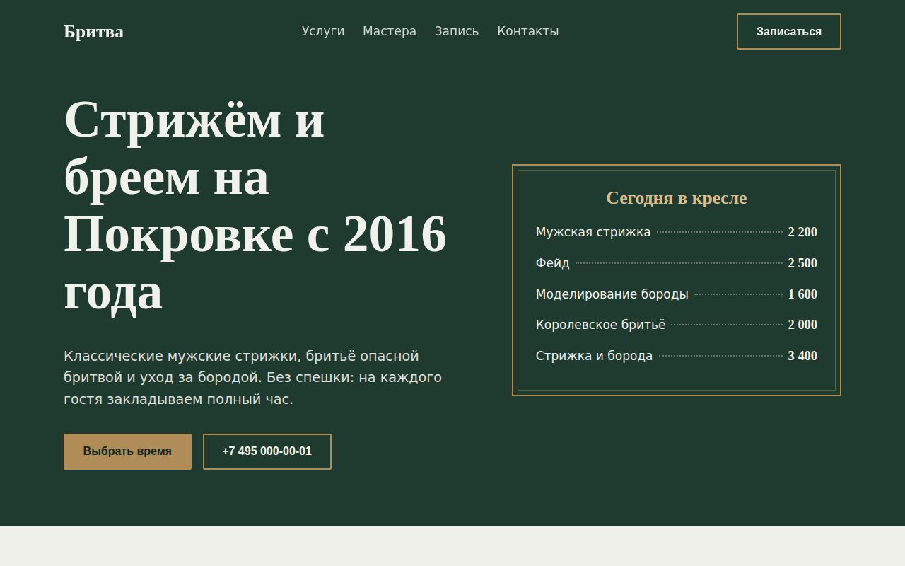

# Бритва: барбершоп

Лендинг барбершопа с пошаговой онлайн-записью к мастеру. Карточка записи обновляется на каждом шаге, а занятость слотов считается детерминированно, поэтому расписание выглядит живым без сервера.



## Возможности

**Запись в четыре шага**
- Услуга → мастер → день и время → контакты, индикатор шагов сверху
- Шесть услуг с ценой и длительностью, четыре мастера и вариант «Любой свободный»
- Дни на 10 дней вперёд, время с шагом 30 минут по часам работы конкретного дня
- Прошедшее время скрыто, занятые слоты недоступны, день без свободного времени выключен
- Кнопка «Далее» активна только после выбора на текущем шаге
- Карточка «Ваша запись»: услуга, мастер, время, длительность, сумма
- Проверка имени и телефона, маска `+7 (___) ___-__-__`, итоговое сообщение

**Остальная страница**
- Прайс в стиле доски в первом экране
- Карточки мастеров с кнопкой «Записаться к …»: она выбирает мастера и ведёт в нужный шаг
- Статус «Открыто до …» или «Закрыто, откроемся в …» по текущему времени
- Таблица часов работы с выделенным сегодняшним днём

## Стек

HTML5, CSS3 (Grid, custom properties), JavaScript без библиотек, шрифты Old Standard TT и Jost из Google Fonts.

## Как запустить

Сборка не нужна: откройте `index.html` в браузере.

Или через локальный сервер:

```bash
python -m http.server 8000
# затем http://localhost:8000
```

## Настройка

Все данные лежат в начале скрипта в `index.html`:
- `SERVICES`: название, цена, длительность в минутах, описание
- `MASTERS`: имя, стаж, специализация, буква для портрета
- `HOURS`: часы открытия и закрытия по дням недели, от понедельника до воскресенья

## Структура проекта

```
index.html    # вёрстка, стили и скрипт в одном файле
```

## Как это устроено

- Вся запись описана одним объектом состояния `booking`, а `render()` по нему перерисовывает панели, шаги, кнопки и карточку итога
- Занятость слота это хеш от даты, времени и id мастера. Для «Любого свободного» слот занят, только если заняты все мастера
- Слоты дня строятся по `HOURS`, индекс дня недели переводится в формат «понедельник первый»
- Подпись «Записаться к Артёму» собирается заменой окончания имени на дательный падеж
- Доступность: `aria-pressed` у вариантов выбора, `aria-current="step"` у текущего шага, `aria-live` у карточки итога, `aria-invalid` у полей с ошибкой
- `prefers-reduced-motion` отключает плавную прокрутку, до 860 px запись и контакты в одну колонку

## Идеи для развития

- Учитывать длительность услуги при поиске свободного окна
- Отмена и перенос записи по ссылке
- Отправка записи в Telegram-бота мастеру

## Лицензия

Концепт-сайт, реального бизнеса за ним нет.

MIT © 2026 whysafe. Telegram: [@yawhysafe](https://t.me/yawhysafe) · Сайт: [whysafe.ru](https://whysafe.ru)
